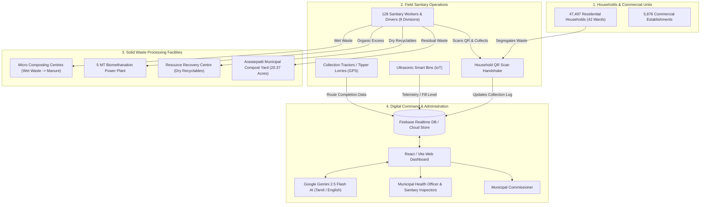

# System Architecture & Workflow: Rajapalayam Municipality

This document outlines the end-to-end architecture and workflow of the **Smart Waste 360** platform for **Rajapalayam Municipality** (*ராஜபாளையம் நகராட்சி*), Virudhunagar District, Tamil Nadu.

---

## 1. High-Level Architectural Flow

---

## 2. Stakeholder Dashboards & Workflows

### 2.1 Household Citizen Workflow
1. **Access:** Login with Ward (`W08`), Street (`S02`), House (`H012`), and 4-digit PIN.
2. **Features:**
   * View daily collection status and scheduled pickup slot (06:30 AM – 11:30 AM).
   * Download personal QR Code for doorstep scanning.
   * Check segregation score and accumulated green reward points.
   * Chat in Tamil or English with the Smart Bin Assistant.

### 2.2 Field Collector (தூய்மை பணியாளர்) Workflow
1. **Access:** Collector ID (`COL001`) and password.
2. **Features:**
   * **My Route:** Follow optimized collection path across Rajapalayam landmarks (Tenkasi Road, Old Bus Stand, Panju Market, Railway Feeder Road, Mudangiar MCC).
   * **QR Scanner:** Scan household QR codes with location and timestamp validation.
   * **Report Violations:** Log non-segregated or hazardous waste incidents.

### 2.3 Municipal Commissioner & Division Inspectors
1. **Access:** Admin ID (`MUN001` / `OFF001`).
2. **Features:**
   * **Live Bin Map:** Leaflet map centered at `[9.4532, 77.5550]` displaying real-time fill levels (Green <50%, Amber 50-70%, Yellow 70-90%, Red >90%).
   * **Division Oversight:** Real-time analytics across the 9 Sanitary Divisions and 42 administrative wards.
   * **Predictive Surge Planning:** Automated calendar alerts for local events (e.g., Panguni Pongal, Ayyanar Kovil pilgrimage, cotton ginning season).

---

## 3. Database Schema Overview

* **HouseholdUser:** `id`, `wardNumber (W01-W42)`, `streetNumber`, `houseNumber`, `pin`, `rewardPoints`, `aadharNumber`, `ebNumber`.
* **SmartBin:** `id`, `binId (RAJ-BIN-*)`, `location: { lat, lng, address }`, `wardNumber`, `fillLevel (%)`, `wasteType`, `status`, `lastUpdated`.
* **WasteLog:** `id`, `houseId`, `collectorId`, `wasteType ('organic'|'recyclable'|'hazardous')`, `weight (kg)`, `fillLevel`, `mlConfidence`, `timestamp`.
* **Collector:** `id`, `collectorId`, `name`, `assignedWard (W01-W42)`, `phone`.
* **MunicipalAdmin:** `id`, `adminId`, `name`, `role ('municipal_admin')`, `municipality ('Rajapalayam Municipality')`, `email`.
